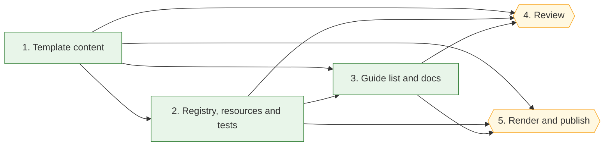

<!-- generated by openspec-graph render; do not edit -->
# Graph — glab50-template-resources

Source: tasks.md@f02565e55983 · Nodes: 5 · Edges: 9 · Layers: 4 · Width: 2 · Ratio: 1.3 · Ready: 0

## Graph

Rectangle = work node, hexagon = gate. Green = done, yellow = gate. No node is ready or blocked.

## Layers

| Layer | Node | Tasks | Owner | Gate | Depends on | State |
|---|---|---|---|---|---|---|
| 1 | 1. Template content | 1.1–1.6 | js-eng | unit | — | done |
| 2 | 2. Registry, resources and tests | 2.1–2.4 | golang-eng | unit | 1 | done |
| 3 | 3. Guide list and docs | 3.1–3.2 | api-documenter | unit | 1, 2 | done |
| 4 | 4. Review | 4.1 | code-reviewer | review | 1, 2, 3 | done |
| 4 | 5. Render and publish | 5.1–5.3 | qa-eng | qa | 1, 2, 3 | done |

## Next batch

None — every node is done; the change is ready to archive.

Deferred: none. Blocked: none.

## Conflicts

None.

## Coverage

Nodes 4 and 5 cover every TC through `Covers: all`; the table lists the nodes that name each TC explicitly.

| TC | Nodes |
|---|---|
| TC-830 | 1, 5 |
| TC-833 | 2, 3 |
| TC-834 | 1, 2 |
| TC-835 | 1, 2, 5 |
| TC-836 | 1, 2 |
| TC-837 | 1, 2, 5 |
| TC-838 | 1, 2 |
| TC-839 | 3 |

## Critical path

1 → 2 → 3 → 4 (4 nodes)

## Warnings

None. The plan has two nodes in layer 4, every node carries a behavioral check, and every unit node
covers at least one TC.
