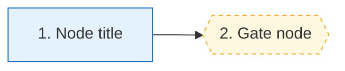

<!-- generated by openspec-graph render; do not edit -->
# Graph — <!-- change name -->

Source: tasks.md@<!-- 12-char sha256 of tasks.md --> · Nodes: <!-- n --> · Edges: <!-- n --> · Layers: <!-- n --> · Width: <!-- n --> · Ratio: <!-- n.n --> · Ready: <!-- n -->

## Graph

Rectangle = work node, hexagon = gate. Green done, blue ready, grey dashed blocked.

## Layers

| Layer | Node | Tasks | Owner | Gate | Depends on | State |
|---|---|---|---|---|---|---|
| <!-- 1 --> | <!-- 1. Node title --> | <!-- 1.1–1.3 --> | <!-- agent --> | <!-- unit --> | <!-- none --> | <!-- ready --> |

## Next batch

| Node | Owner | Why | Feeds |
|---|---|---|---|
| <!-- 1. Node title --> | <!-- agent --> | <!-- ready, no conflict --> | <!-- 2 --> |

Deferred: <!-- none, or node and reason -->
Blocked: <!-- none, or node and waiting-on ids -->

## Conflicts

| Pair | Kind | Detail |
|---|---|---|
| <!-- none --> | <!-- owns, resource or max --> | <!-- detail --> |

## Coverage

| TC | Nodes |
|---|---|
| <!-- TC-… --> | <!-- node ids --> |

## Critical path

<!-- 1 → 2 → 4 -->

## Warnings

| Code | Node | Detail |
|---|---|---|
| <!-- none --> | <!-- id --> | <!-- detail --> |
