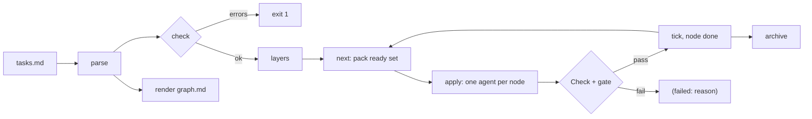

# OpenSpec task graph — tasks.md schema v1

> The canonical definition of the `tasks` artifact for graph-driven OpenSpec changes. Design and spec
> artifacts are unchanged; `proposal.md` is dropped.

## Context

OpenSpec's `tasks` artifact is a flat checklist: `apply.tracks: tasks.md` and `openspec instructions
apply --json` see individual checkboxes with no group, dependency or owner information. The work
already has a graph shape — groups of work, dependencies, file ownership, verification gates — but it
lives in prose that no tool can validate. This spec defines a strict, Markdown-native grammar for that
graph so it stays the single source of truth OpenSpec already tracks, while a small CLI can check it,
compute layers, pack run batches and render a view.

## Goals

- A `tasks.md` that is both human-reviewable and machine-parseable, with no second file to drift.
- Nodes, edges, write sets, resource conflicts and gates as explicit fields.
- Layers and parallel batches computed per run; nothing scheduled by hand.
- A validator with stable error codes, a `next` command that returns the runnable batch, and a
  generated visual.
- Forward-only adoption: marked files are enforced; legacy and archived files are untouched.
- A project-local OpenSpec schema package that carries the format: the `spec-driven` spec and design
  artifacts, plus `tasks` and the generated graph view.

## Non-goals

- Conditional edges, loops, retries or a durable run store. v1 is an acyclic graph per change.
- Cross-change or portfolio edges (capability → change → ticket).
- A GUI, daemon or database; commands are read-only except `render`.
- Rewriting archived changes.
- Replacing OpenSpec's checkbox progress or archive gate.
- New artifact types beyond `graph`; `design.md` and `specs/**` keep their `spec-driven` content.

## Flow



## Decisions

### D1: A node is a group of work
- **Choice**: one `### N. <title> — <agent>` group is one graph node; `N.x` checkboxes are its
  internal sequence.
- **Why**: the group is the unit a subagent takes, the unit that declares `Owns:`, and the unit that
  runs in parallel. Task-level nodes would mirror the 32 booleans OpenSpec already stores without
  adding a scheduling decision.
- **Alternatives**: task-per-node (noisy, duplicates progress); hybrid with cross-group task edges
  (rejected — split the group instead).

### D2: Waves are deleted
- **Choice**: no `## Wave` headings. Layers are computed from `Depends on:`; each run's batch is
  computed from conflicts plus a concurrency cap.
- **Why**: a wave duplicates the edge information and can disagree with it. Parallelism is a run-time
  condition (DB, ports, build cache, agent capacity), not a property of the plan.
- **Alternatives**: authored batches with a `wave >= layer` invariant (rejected — second ordering
  source); pure topological rendering with no cap (rejected — unbounded fan-out).

### D3: The graph is derived from Markdown
- **Choice**: parse nodes from headings and metadata lines in `tasks.md`; no sidecar file, no fenced
  YAML block.
- **Why**: `apply.tracks` needs the checkboxes, and a duplicate representation drifts. The file is
  already the progress source; make it the structure source too.
- **Alternatives**: `graph.yaml` sidecar; YAML block inside the file; YAML-only tasks file (breaks
  `apply.tracks` and archive validation).

### D4: `graph.md` is a generated fifth artifact
- **Choice**: add a `graph` artifact to the schema — `generates: graph.md`, `requires: [tasks]`, listed
  in `apply.requires`. `openspec-graph render` writes it; it is committed and stamped with the source
  hash.
- **Why**: an artifact is visible in `openspec status` and `instructions`, and propose creates it
  because it is an ancestor of `apply.requires`. Its content stays derived; the hash check (`G016`)
  catches staleness, and apply regenerates it at each transition.
- **Alternatives**: an unregistered generated file (invisible to status and propose); a CI-only
  comment (not reviewable); no visual at all.

### D5: Opt-in marker
- **Choice**: the first line `<!-- openspec-graph: 1 -->` opts a file into the grammar. Files without
  it are ignored by `check`; archives are never rewritten.
- **Why**: 148 archived changes exist; a migration is not the point. Forward-only adoption.
- **Alternatives**: enforce everywhere (baseline noise, rewrites); a config flag (per-repo, not
  per-change).

### D6: A project-local schema package with the `spec-driven` artifacts plus `graph`
- **Choice**: ship `task-graph` as a project-local schema. It lives in
  `.openspec/schemas/task-graph/` in the config repo and is copied to
  `openspec/schemas/task-graph/` when a project adopts it. It declares `specs`, `design`, `tasks` and
  `graph`: `specs` and `design` are roots, `tasks` requires both, `graph` requires `tasks`. Only the
  `tasks`, `graph` and `apply` instructions change.
- **Why**: the format needs a home OpenSpec can resolve, and a fork with identical artifacts keeps
  the document DAG unchanged. Names, templates and instructions travel with the schema instead of
  being copied into every project's config.
- **Alternatives**: no schema, only `rules.tasks` (no template, no apply instruction); new artifacts
  `contracts.md`/`test-plan.md` (more ceremony, no execution semantics); engine patch (upstream
  drift).

### D7: Review and QA are explicit nodes
- **Choice**: `Gate: review` and `Gate: qa` nodes live in `tasks.md` with an `Evidence:` path.
- **Why**: a gate that exists only in prose cannot be checked; `glab53`-style manual gates work but
  are invisible to tooling.
- **Alternatives**: implicit apply steps (invisible, drift); schema artifacts (file existence is not
  a verdict).

### D8: `Covers: all` is reserved for gates
- **Choice**: only `Gate: review` and `Gate: qa` nodes may write `Covers: all`.
- **Why**: those nodes inspect the whole diff; an implementation node claiming `all` hides what it
  actually covers.
- **Alternatives**: forbid `all` (forces enumerating every TC on a review node, which adds no
  information); allow anywhere (coverage becomes meaningless).

## Configurations

### 1. Opt-in marker

First line of the file, exact:

```
<!-- openspec-graph: 1 -->
```

A different version number is error `G001`. A file without the marker is not parsed.

### 2. File shape

```
<!-- openspec-graph: 1 -->

# Tasks

### <id>. <title> — <agent>
Depends on: <none | id, id, …>
Owns: <none | path, path, …>
Resource: <tag, tag, …>          # optional
Gate: <unit | review | qa | human | none>   # optional, default unit
Evidence: <repo-relative path>   # required when Gate is review, qa or human

- [ ] <id>.<n> <text> Check: <command> Covers: <TC-…, TC-… | all>
```

Nodes may appear in any order; ids must be continuous from 1. `# Tasks` is the only required heading;
`##` headings are ignored. Fenced code blocks are ignored while parsing.

### 3. Node fields

| Field | Required | Grammar | Default | Error if |
|---|---|---|---|---|
| heading | yes | `### <id>. <title> — <owner>`; owner is kebab-case | — | missing `—`, non-numeric id, duplicate id |
| `Depends on:` | yes | `none` or `id` (`, ` `id`)* | — | unknown id, prose, self-edge, cycle |
| `Owns:` | yes | `none` or path (`, ` path)* | — | empty |
| `Resource:` | no | tag (`, ` tag)*; tag `[a-z][a-z0-9:-]*` | none | malformed tag |
| `Gate:` | no | `unit` \| `review` \| `qa` \| `human` \| `none` | `unit` | unknown value |
| `Evidence:` | gate ≠ unit | repo-relative path | — | missing path for review/qa/human |
| task | ≥1 per node | `- [ ] <id>.<n> <text> Check: <cmd> Covers: <ids>`; the prefix must equal the enclosing node id | — | missing `Check:`, missing `Covers:`, duplicate task id, prefix mismatched to the node |

Task line parsing: split on the **last** occurrence of ` Covers: `; the text before it must contain
exactly one ` Check: `, which splits the description from the command. Backticks around a command are
stripped but not required. `[x]` means done; every other marker is unfinished (OpenSpec rule).

### 4. Semantics

**Edges.** `Depends on:` is the only edge source. A node may start when every dependency is `done`.
Transitive dependencies are implicit; listing a transitive dependency is warning `W001`.

**Layers.** `layer(n) = 1 + max(layer(dep))`; roots are layer 1. Computed, never written.

**Correlation.** The task id prefix is the join key: node `N` owns every `- [ ] N.x` line in its
block. The parser scopes a node from its `###` heading to the next node heading and errors when a
task's prefix differs (`G017`). `graph.md` names the range per node, `next` returns node ids, and the
node state is the aggregate of its tasks. OpenSpec flattens checkboxes to sequential ids, so the CLI
correlates to them by source `line`, never by id.

**States.**

| State | Condition |
|---|---|
| `blocked` | some dependency is not `done` |
| `ready` | dependencies `done`, no task touched |
| `running` | some task `[x]`, or a task carries `(blocked: …)` |
| `done` | every `<id>.<n>` task `[x]` and the gate is satisfied |
| `failed` | a task carries `(failed: …)`, or the gate evidence records a failure |
| `skipped` | heading carries `(skipped: <reason>)`; its boxes tick with the same reason |

**Batches.** Deterministic packing:

```
ready  = nodes with state == ready
batch  = []
for node in ready sorted by (layer, id):
    if len(batch) == max:            defer(node, "max")
    elif owns_overlap(node, batch):  defer(node, "owns")
    elif resource_overlap(node, batch): defer(node, "resource")
    else: batch.append(node)
```

`owns_overlap` compares resolved paths: equal, one a directory prefix of the other, or both in the
same Go package directory. `resource_overlap` compares tag sets. Default `max` is 4; `--max 1`
serializes. A deferred node is eligible, not blocked; `next --explain` names the reason.

**Planning for parallelism.** An edge is real only when the dependent cannot pass a `Check:` without
the dependency's output. Name that output — a path in `Owns:`, an exported interface, or a `TC-…`.
If you cannot name it, drop the edge; chaining nodes "to be safe" is the main source of serial plans.
Independent roots are the default, and shared contracts or hotspot files go in one early node that
others depend on, never in several siblings. A change with four or more nodes should have at least
one layer with two nodes.

**Self-containment.** A node owns every file it writes, plus the tests and fixtures that prove its
behavior. It must pass its checks with only its ancestors' work in the tree: no file it needs belongs
to a non-ancestor, and no test depends on a later node. Tests and docs for a node's behavior land in
that node, not in a final catch-all. Gate nodes (`review`, `qa`) only verify; they do not fix, and
their findings reopen the owning node. A check that names a non-ancestor's file is warning `W009`:
either add the edge or move the file into this node.

**Shared files.** If two nodes must write the same file, either merge them or extract the file (or its
interface) into an earlier contract node. A file owned by two unrelated nodes is warning `W008`.

### 5. Invariants

Errors (exit 1):

| Code | Condition |
|---|---|
| `G001` | unknown marker version |
| `G002` | malformed node heading |
| `G003` | duplicate or non-continuous node id |
| `G004` | missing `Depends on:` or `Owns:` |
| `G005` | dependency names an unknown node |
| `G006` | cycle |
| `G007` | malformed `Depends on:` (wave, group, range, prose) |
| `G008` | duplicate task id inside a node |
| `G009` | task without `Check:` or without `Covers:` |
| `G010` | `Covers:` names a TC absent from `design.md` and the main specs (`openspec/specs/**/spec.md`) |
| `G011` | a TC in `design.md` is covered by no node |
| `G012` | `Covers: all` on a non-gate node |
| `G013` | `review`/`qa`/`human` gate without `Evidence:` |
| `G014` | `review`/`qa` node does not depend on every implementation node it inspects |
| `G015` | doc obligation missing: migration → `docs/database.md`; sync jobs → `docs/background-jobs.md`; new domain → `docs/architecture.md` + `doc.go` |
| `G016` | `graph.md` source hash does not match `tasks.md` |
| `G017` | task id prefix does not match the enclosing node id |
| `G018` | `check --diff` finds a changed file outside the union of the change's `Owns:` paths |

Warnings (exit 0):

| Code | Condition |
|---|---|
| `W001` | redundant transitive dependency |
| `W002` | node always deferred by an `Owns:`/`Resource:` clash |
| `W003` | node depends on a higher id (readability only) |
| `W004` | fully serial graph: four or more nodes and every layer has width 1 |
| `W005` | edge without a visible contract: the dependent's tasks and `Owns:` never name a path, interface or TC from the dependency |
| `W006` | node has no behavioral check: no `Check:` invokes a test runner (`go test`, `make test`, `hurl`, `vitest`, `playwright`, …) and `Gate` is not `none` |
| `W007` | `Gate: unit` node covers no TC |
| `W008` | `Owns:` path shared by two nodes where neither is an ancestor of the other |
| `W009` | a task `Check:` names a path owned by a node that is not an ancestor (hidden dependency) |

`check --changed` scopes every rule to files in the diff that carry the marker.

### 6. graph.md

Fifth artifact of the schema: `generates: graph.md`, `requires: [tasks]`, listed in
`apply.requires`. Path `openspec/changes/<change>/graph.md`. First lines:

```
<!-- generated by openspec-graph render; do not edit -->
# Graph — <change>
Source: tasks.md@<sha256-of-tasks.md, first 12 hex> · Nodes: N · Edges: E · Layers: L · Width: W · Ratio: R · Ready: N
```

`Width` is the largest number of nodes in one layer; `Ratio` is `nodes / critical-path length`,
one decimal. A ratio of 1.0 means the plan is fully serial (`W004`).

Required sections, in order: `## Graph` (Mermaid flowchart), `## Layers` (table: layer, node, task
range, owner, gate, depends on, state), `## Next batch` (table: node, owner, why, feeds; plus
deferred and blocked lines), `## Conflicts` (pairs: owns, resource, max), `## Coverage` (TC → nodes),
`## Critical path`. Optional `## Warnings` lists every warning code with its node. The task range
(`2.1–2.4`) is the node-to-task join key.

Determinism: nodes sorted by id, edges by `(from, to)`, tables by id, so `render --check` produces an
empty diff when nothing changed. Mermaid labels are quoted, `;` and `#` stripped, `end` never used as
an id; run `mmdc` when installed.

### 7. CLI contract

`bin/openspec-graph` — Node, no runtime dependencies.

| Command | Output | Exit |
|---|---|---|
| `check <change> [--changed] [--diff [--base <ref>]] [--json]` | `{errors:[{code,node,line,message}], warnings:[…]}`; `--diff` adds `G018` from `git diff --name-only` | 1 on errors |
| `next <change> [--max N] [--explain] [--json]` | `{batch:[id], deferred:[{id,reason}], blocked:[{id,waitingOn}], ready:[id]}` | 0, or 1 if no marker |
| `render <change> [--check]` | writes `graph.md`, or diffs with `--check` | 1 on drift or parse error |
| `baseline [--archived] [--json]` | counts per code over unmarked files | 0 always |

Canonical parsed model (shared by all commands):

```json
{
  "schema": 1,
  "change": "add-order-export",
  "sourceHash": "7f3a1c9d2b04",
  "nodes": [{
    "id": 1,
    "title": "Migration and entity",
    "owner": "golang-eng",
    "dependsOn": [],
    "owns": ["internal/pkg/entity/export.go"],
    "resources": ["db:test"],
    "gate": "unit",
    "evidence": null,
    "layer": 1,
    "state": "ready",
    "tasks": [{"id": "1.1", "text": "…", "check": "…", "covers": ["TC-101"], "done": false}]
  }],
  "edges": [{"from": 1, "to": 2}]
}
```

### 8. OpenSpec integration

- `tasks.md` stays at `openspec/changes/<change>/tasks.md`; `apply.tracks` and the checkbox format are
  unchanged.
- `openspec validate --archived` remains the completion gate; `openspec status` remains the artifact
  gate.
- `openspec/config.yaml` `rules.tasks` describes the grammar; apply-time doctrine goes in
  `operations.apply.guidance`, since `rules` is injected only into `instructions <artifact>`.
- `graph.md` is committed and travels with the change when archived.
- No change to `design.md` or `specs/**`.

### 9. Schema package

```
.openspec/schemas/task-graph/
  schema.yaml                 # specs, design, tasks + graph; apply requires [tasks, graph]
  templates/
    spec.md                   # unchanged
    design.md                 # unchanged
    tasks.md                  # graph skeleton with the marker
    graph.md                  # generated view skeleton with the source-hash line
```

- Source of truth in this repo: `.openspec/schemas/task-graph/`. OpenSpec resolves schemas at
  `<project>/openspec/schemas/<name>/` and `openspec schema validate` reads `process.cwd()`; a
  dot-directory is a staging area, not a discoverable root.
- Adoption copies the directory to `openspec/schemas/task-graph/` in the project, then either
  `openspec new change <name> --schema task-graph` per change or `schema: task-graph` in
  `openspec/config.yaml` for a default.
- `schema.yaml` uses only the keys the 1.16 loader accepts: `name`, `version`, `description`,
  `artifacts[]` (`id`, `generates`, `description`, `template`, `instruction`, `requires`) and
  `apply` (`requires`, `tracks`, `instruction`). Unknown keys are silently stripped, so no gate or
  validator fields may be added there.
- The package was validated with `openspec schema validate task-graph` against a scratch project:
  exit 0, `openspec status` lists the four artifacts, `applyRequires: [tasks, graph]`, and the tasks
  instruction resolves to the graph grammar.

## Testing

### Pre-test requirements

- Fixture directory `test/fixtures/graph/`, no database, no network.
- One valid 5-node fixture and one fixture per error code.

### Scenario

| Given | When | Then |
|---|---|---|
| valid 5-node fixture | `check` | exit 0, no errors |
| node with `Depends on: Wave 1` | `check` | `G007`, line reported |
| dependency on a missing id | `check` | `G005` |
| 1 → 2 → 1 | `check` | `G006` |
| two ready nodes with overlapping `Owns:` | `next` | second is `deferred: owns` |
| two ready nodes share `Resource: db:test` | `next` | second is `deferred: resource` |
| 6 ready nodes, `--max 2` | `next` | 2 in batch, 4 `deferred: max` |
| `Covers: all` on `Gate: unit` | `check` | `G012` |
| review node without `Evidence:` | `check` | `G013` |
| `graph.md` older than `tasks.md` | `render --check` | exit 1, hash mismatch |
| file without the marker | `check` | skipped, not an error |
| unmarked legacy `tasks.md` | `baseline` | counted, never fails |
| schema package copied into `openspec/schemas/` | `openspec schema validate task-graph` | exit 0; four artifacts; `applyRequires: [tasks, graph]`; tasks instruction carries the grammar |

## Open Questions

- [ ] Where does the validator live when implemented — `bin/openspec-graph.mjs` per repo, or one
  shared package? Blocks P0 only.
- [ ] Do `Resource:` tags stay free-form, or become a fixed vocabulary (`db`, `port`, `build`,
  `browser`)? Free-form is the default; an observed clash can promote a tag.
- [ ] Default `--max`: 4, or derived from the number of available implementation agents?

## Todo

Schema package landed (`.openspec/schemas/task-graph/`). Validator and adoption are not started.
Wave headings below are this spec's delivery layers, not the change-task format described above.

### Wave 1 — Parser and checker
- [x] [js-eng] Package the `task-graph` schema and templates; validate with `openspec schema validate` — `.openspec/schemas/task-graph/`
- [x] [js-eng] Add the `graph` artifact (`requires: [tasks]`, in `apply.requires`) with its template and render instruction — `.openspec/schemas/task-graph/`
- [ ] [js-eng] Implement `bin/openspec-graph.mjs` parser + `check` with codes `G001–G015`, verify against fixtures — `test/fixtures/graph/`
- [ ] [js-eng] Unit tests for every code and for the valid fixture — same directory

### Wave 2 — Compute and render
- [ ] [js-eng] Add `next` (layers, states, deterministic packing, `--max`, `--explain`) and `render`/`--check` with `graph.md` — `bin/openspec-graph.mjs`
- [ ] [js-eng] Tests for packing order, deferral reasons, determinism and hash staleness — `test/fixtures/graph/`

### Wave 3 — Adoption
- [ ] [general] Wire `rules.tasks`, `operations.apply.guidance`, `make graph-check` and CI `check --changed` + `render --check` in the adopting repo
- [ ] [code-reviewer] Review the CLI and the first marked `tasks.md` against this spec
